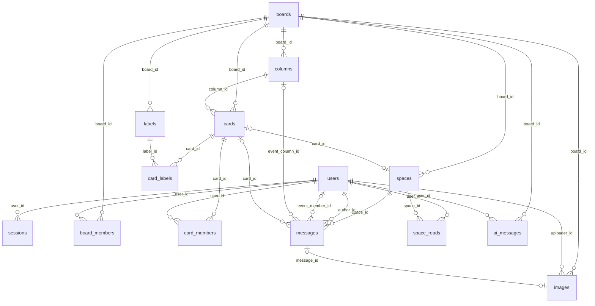

# Database design (Part 5)

Status: **approved design, implemented in Part 6** (`backend/migrations/0001_init.sql`). SQLite, one file (`/data/tidy.db` in the container), created automatically when missing.

- `docs/schema.json` is the machine-readable source of truth (14 tables, 16 named indexes). `backend/migrations/0001_init.sql` is generated from it, and `tests/test_migrations.py` compares the created database with `schema.json` (tables, columns, types, nullability, keys, foreign keys with ON DELETE, indexes, STRICT) so the two cannot drift.
- This file gives the reasons. The ER diagram and the table sections in section 1 are generated from `schema.json`.
- It holds everything the app stores, including chat messages, images, user settings, unread state and the AI conversation. Nothing but light UI state (such as the last open view) stays in the browser.

## 1. Tables and relationships

Reading the diagram: a line is a foreign key; `||` is "exactly one parent", `|o` is "optional parent", `o{` is "many children", `o|` is "at most one child".

**ON DELETE rules**

- **CASCADE** when the child is part of the parent: a board takes all its data with it; a card takes its labels, assignees, room, messages and announcements; a message takes its image; a space takes its messages and read state; a user takes their sessions, memberships, assignments, read markers and AI thread.
- **RESTRICT** when history must never disappear silently: a user who wrote messages cannot be deleted.
- **NO ACTION** on `cards.column_id`: a column that still holds cards cannot be deleted (move the cards first), but deleting a whole board still works, because the check runs at the end of the statement. Verified with the table creation order reversed, so it does not depend on cascade order.
- **SET NULL** only on `messages.event_column_id`: old "moved" events survive a deleted column.

**Rules a database cannot express** (enforced in code, tested in Part 6): a card's column, labels and assignees belong to the card's board; a message is posted only in a space of a board its author belongs to; a user may only read boards they are a member of.

Columns are NOT NULL unless marked `null`.

### `users`

Everyone on a team. Only users with a password_hash can sign in. Also holds the per-user settings.

| Column | Type | Constraints | Notes |
|---|---|---|---|
| `id` | TEXT | PK | UUID v4 text, generated by the client or the server |
| `username` | TEXT | UNIQUE; collate nocase | sign-in name, case-insensitive |
| `password_hash` | TEXT | null | scrypt 'salt_hex:hash_hex'; NULL = this user cannot sign in |
| `name` | TEXT |  | display name as written (English for sample users) |
| `name_fa` | TEXT | null | Persian display name, sample users only |
| `initials` | TEXT |  | avatar letters |
| `initials_fa` | TEXT | null |  |
| `language` | TEXT | default `'en'`; check `language IN ('en','fa')` | UI language setting |
| `density` | TEXT | default `'comfortable'`; check `density IN ('comfortable','compact')` | card density setting |
| `created_at` | TEXT |  | UTC ISO 8601, e.g. 2026-11-15T08:30:00.000Z |

### `sessions`

Signed-in browsers. The cookie holds a random token; only its SHA-256 is stored here.

| Column | Type | Constraints | Notes |
|---|---|---|---|
| `token_hash` | TEXT | PK | SHA-256 hex of the cookie token |
| `user_id` | TEXT | FK `users(id)` ON DELETE **CASCADE** |  |
| `created_at` | TEXT |  | UTC ISO 8601, e.g. 2026-11-15T08:30:00.000Z |
| `expires_at` | TEXT |  | UTC ISO 8601 |

- Index `idx_sessions_user` (user_id)
- Index `idx_sessions_expires` (expires_at) - purging expired sessions

### `boards`

A Kanban board. Everything a team sees hangs off a board.

| Column | Type | Constraints | Notes |
|---|---|---|---|
| `id` | TEXT | PK | UUID v4 text, generated by the client or the server |
| `created_at` | TEXT |  | UTC ISO 8601, e.g. 2026-11-15T08:30:00.000Z |

### `board_members`

Who is on a board's team, in display order. The owner is the user who signs in; teammates may be users who cannot sign in.

| Column | Type | Constraints | Notes |
|---|---|---|---|
| `board_id` | TEXT | PK; FK `boards(id)` ON DELETE **CASCADE** |  |
| `user_id` | TEXT | PK; FK `users(id)` ON DELETE **CASCADE** |  |
| `role` | TEXT | check `role IN ('owner','member')` |  |
| `position` | INTEGER | check `position >= 1` | display order, 1 = first |

- Primary key: (board_id, user_id)
- Index `idx_board_members_user` (user_id) - find a user's board at sign-in
- Unique index `uq_board_one_owner` (board_id) where `role = 'owner'` - exactly one owner per board
- Unique index `uq_user_one_owned_board` (user_id) where `role = 'owner'` - MVP rule: one board per user. Dropping this index lifts it.

### `columns`

The fixed board columns (ideas, todo, doing, review, done). Only the name, WIP limit and collapsed state change.

| Column | Type | Constraints | Notes |
|---|---|---|---|
| `id` | TEXT | PK | UUID v4 text, generated by the client or the server |
| `board_id` | TEXT | FK `boards(id)` ON DELETE **CASCADE** |  |
| `slug` | TEXT |  | stable identity: ideas, todo, doing, review, done. The API exposes it as the column id. |
| `name` | TEXT | null | set only when the user renames the column; NULL = show the translated default |
| `position` | INTEGER | check `position >= 1` | column order, 1 = leftmost |
| `wip_limit` | INTEGER | null; check `wip_limit IS NULL OR wip_limit > 0` | NULL = no limit |
| `collapsed` | INTEGER | default `0`; check `collapsed IN (0,1)` | boolean |

- Unique: (board_id, slug)
- Unique: (board_id, position)

### `labels`

A board's labels (design, frontend, bug, docs, testing). The label colour comes from the slug in the UI.

| Column | Type | Constraints | Notes |
|---|---|---|---|
| `id` | TEXT | PK | UUID v4 text, generated by the client or the server |
| `board_id` | TEXT | FK `boards(id)` ON DELETE **CASCADE** |  |
| `slug` | TEXT |  | stable identity used for the colour |
| `name` | TEXT |  | label name as written (English for sample labels) |
| `name_fa` | TEXT | null | Persian name, sample labels only |
| `position` | INTEGER | check `position >= 1` | display order, 1 = first |

- Unique: (board_id, slug)

### `cards`

Kanban cards. Deleting a card sets deleted_at (so Undo restores it exactly); a purge removes it for good later.

| Column | Type | Constraints | Notes |
|---|---|---|---|
| `id` | TEXT | PK | UUID v4 text, generated by the client or the server |
| `board_id` | TEXT | FK `boards(id)` ON DELETE **CASCADE** | repeated from the column so access checks need no join |
| `column_id` | TEXT | FK `columns(id)` ON DELETE **NO ACTION** |  |
| `position` | INTEGER |  | order inside the column, gapped integers (steps of 1024); see DATABASE.md section 3 |
| `seq` | INTEGER | check `seq >= 1` | creation order within the board; orders the rooms list |
| `title` | TEXT |  | as written (English for sample cards) |
| `title_fa` | TEXT | null | Persian title, sample cards only |
| `details` | TEXT | default `''` |  |
| `details_fa` | TEXT | null | Persian details, sample cards only |
| `priority` | TEXT | default `'medium'`; check `priority IN ('low','medium','high')` |  |
| `due_date` | TEXT | null; check `due_date IS NULL OR date(due_date) IS due_date` | Gregorian yyyy-MM-dd, a calendar day (not an instant); shown in the Jalali calendar |
| `progress` | INTEGER | default `0`; check `progress BETWEEN 0 AND 100` |  |
| `created_at` | TEXT |  | UTC ISO 8601, e.g. 2026-11-15T08:30:00.000Z |
| `deleted_at` | TEXT | null | UTC ISO 8601; NULL = live |

- Unique: (board_id, seq)
- Index `idx_cards_column_order` (column_id, position, seq) - reading a column in order
- Index `idx_cards_deleted` (deleted_at) where `deleted_at IS NOT NULL` - purging old deleted cards

### `card_labels`

Labels on a card, in the order they were added.

| Column | Type | Constraints | Notes |
|---|---|---|---|
| `card_id` | TEXT | PK; FK `cards(id)` ON DELETE **CASCADE** |  |
| `label_id` | TEXT | PK; FK `labels(id)` ON DELETE **CASCADE** |  |
| `position` | INTEGER | check `position >= 1` | order added |

- Primary key: (card_id, label_id)
- Index `idx_card_labels_label` (label_id)

### `card_members`

Users assigned to a card, in the order they were added (the avatar stack order).

| Column | Type | Constraints | Notes |
|---|---|---|---|
| `card_id` | TEXT | PK; FK `cards(id)` ON DELETE **CASCADE** |  |
| `user_id` | TEXT | PK; FK `users(id)` ON DELETE **CASCADE** |  |
| `position` | INTEGER | check `position >= 1` | order added |

- Primary key: (card_id, user_id)
- Index `idx_card_members_user` (user_id)

### `spaces`

Chat spaces: one General channel per board and one room per card.

| Column | Type | Constraints | Notes |
|---|---|---|---|
| `id` | TEXT | PK | UUID v4 text, generated by the client or the server |
| `board_id` | TEXT | FK `boards(id)` ON DELETE **CASCADE** |  |
| `kind` | TEXT | check `kind IN ('general','card')` |  |
| `card_id` | TEXT | null; UNIQUE; FK `cards(id)` ON DELETE **CASCADE** | the card this room belongs to; NULL for General. The API exposes the space id as 'general' or the card id. |
| `created_at` | TEXT |  | UTC ISO 8601, e.g. 2026-11-15T08:30:00.000Z |

- Check: `(kind = 'card') = (card_id IS NOT NULL)`
- Index `idx_spaces_board` (board_id)
- Unique index `uq_spaces_one_general` (board_id) where `kind = 'general'` - one General channel per board

### `messages`

Everything in a conversation: chat messages, system events (progress, members, moves) and 'task created' announcements.

| Column | Type | Constraints | Notes |
|---|---|---|---|
| `id` | INTEGER | PK autoincrement | monotonic and never reused: gives the order and powers the unread model |
| `space_id` | TEXT | FK `spaces(id)` ON DELETE **CASCADE** |  |
| `author_id` | TEXT | FK `users(id)` ON DELETE **RESTRICT** | the user who wrote it or caused the event |
| `kind` | TEXT | check `kind IN ('message','event','task')` |  |
| `text` | TEXT | null | kind = message only; as written (English for sample messages) |
| `text_fa` | TEXT | null | Persian text, sample messages only |
| `event` | TEXT | null; check `event IS NULL OR event IN ('progress','added','removed','moved','created','updated')` | kind = event only |
| `event_value` | INTEGER | null; check `event_value IS NULL OR event_value BETWEEN 0 AND 100` | progress events |
| `event_member_id` | TEXT | null; FK `users(id)` ON DELETE **RESTRICT** | added / removed events |
| `event_column_id` | TEXT | null; FK `columns(id)` ON DELETE **SET NULL** | moved events |
| `card_id` | TEXT | null; FK `cards(id)` ON DELETE **CASCADE** | kind = task: the card that was created from a message |
| `by_ai` | INTEGER | default `0`; check `by_ai IN (0,1)` | 1 = done by the AI assistant (events only) |
| `created_at` | TEXT |  | UTC ISO 8601, e.g. 2026-11-15T08:30:00.000Z |

- Check: `(kind = 'event') = (event IS NOT NULL)`
- Check: `(kind = 'task') = (card_id IS NOT NULL)`
- Check: `kind = 'message' OR text IS NULL`
- Check: `(event IS 'progress') = (event_value IS NOT NULL)`
- Check: `(event IS NOT NULL AND event IN ('added','removed')) = (event_member_id IS NOT NULL)`
- Check: `by_ai = 0 OR kind = 'event'`
- Index `idx_messages_space` (space_id, id) - a conversation in order; unread counts
- Index `idx_messages_card` (card_id) where `card_id IS NOT NULL` - removing a card's announcements

### `images`

Chat images stored as BLOBs. A row belongs to at most one message. Sample images have no bytes and show as placeholders.

| Column | Type | Constraints | Notes |
|---|---|---|---|
| `id` | TEXT | PK | UUID v4 text, generated by the client or the server |
| `board_id` | TEXT | FK `boards(id)` ON DELETE **CASCADE** | access: only members of this board may read it |
| `uploader_id` | TEXT | FK `users(id)` ON DELETE **RESTRICT** | owner of the upload |
| `message_id` | INTEGER | null; UNIQUE; FK `messages(id)` ON DELETE **CASCADE** | NULL until the message is sent |
| `file_name` | TEXT |  | original file name, shown as the alt text |
| `mime_type` | TEXT | null; check `mime_type IS NULL OR mime_type IN ('image/jpeg','image/png','image/webp')` |  |
| `size_bytes` | INTEGER | default `0`; check `size_bytes BETWEEN 0 AND 2097152` | at most 2 MB |
| `data` | BLOB | null | NULL for sample placeholder images |
| `created_at` | TEXT |  | UTC ISO 8601, e.g. 2026-11-15T08:30:00.000Z |

- Check: `(data IS NULL) = (mime_type IS NULL)`
- Check: `size_bytes = COALESCE(length(data), 0)`
- Index `idx_images_unattached` (created_at) where `message_id IS NULL` - purging uploads that never got a message

### `space_reads`

Unread model: how far each user has read each space. No row = nothing read yet.

| Column | Type | Constraints | Notes |
|---|---|---|---|
| `user_id` | TEXT | PK; FK `users(id)` ON DELETE **CASCADE** |  |
| `space_id` | TEXT | PK; FK `spaces(id)` ON DELETE **CASCADE** |  |
| `last_read_message_id` | INTEGER | default `0`; check `last_read_message_id >= 0` | a plain number, not a foreign key, so deleting a message never touches read state |

- Primary key: (user_id, space_id)
- Index `idx_space_reads_space` (space_id) - cascade when a room is removed

### `ai_messages`

The AI assistant conversation, one continuous thread per user and board.

| Column | Type | Constraints | Notes |
|---|---|---|---|
| `id` | INTEGER | PK autoincrement | orders the thread |
| `board_id` | TEXT | FK `boards(id)` ON DELETE **CASCADE** |  |
| `user_id` | TEXT | FK `users(id)` ON DELETE **CASCADE** |  |
| `role` | TEXT | check `role IN ('user','assistant')` |  |
| `content` | TEXT |  |  |
| `changes` | TEXT | null; check `changes IS NULL OR json_valid(changes)` | JSON list of the board changes the assistant applied (or failed to apply) for this reply |
| `created_at` | TEXT |  | UTC ISO 8601, e.g. 2026-11-15T08:30:00.000Z |

- Index `idx_ai_messages_thread` (board_id, user_id, id)

## 2. Bilingual sample content, and user text

**Decision:** every text that sample data provides in two languages is a pair of columns: `x` (the text as written) and `x_fa` (the Persian text, set only for sample data). Applies to `cards.title`/`details`, `messages.text`, `labels.name`, `users.name`/`initials`.

- **Read rule:** UI language `fa` and `x_fa` is not NULL: show `x_fa`; otherwise show `x`. User-written text has `x_fa` NULL, so it is shown unchanged in both languages and never translated, exactly like a plain string in the frontend's `Text = string | { en, fa }`. The API converts the pair back to `Text`, so components do not change.
- **Write rule:** editing a sample text writes `x` and clears `x_fa` (today the frontend replaces the `{ en, fa }` object by a string). Text from the AI or a user is stored in whatever language it was written in.
- **Column names:** `columns.name` is NULL until the user renames the column; NULL means "show the translated default" from `en.ts` / `fa.ts`.
- **Why not JSON in one column:** a user could type text that looks like JSON, and nothing would tell it apart from a sample pair. **Why not a translations table:** a join for every title, for exactly two languages. Two nullable columns are plain SQL, need no parsing and cost nothing for user text.
- **Sample board:** created in one transaction at the user's first sign-in, from a Python copy of `data/seed.ts`. The seed's `sara` seat is the signed-in user (Atefe Kalamati); Ali, Maryam and Reza are the three users who cannot sign in. Due dates are relative to the creation day, as today. Sample message times keep their spacing but are shifted to end shortly before creation, so none is in the future. Sample images are rows without bytes (placeholders). The owner's read state is set so General shows 2 unread and the task room 1, as in the demo.

## 3. Ordering

**Decision:** `cards.position` is a **gapped integer** per column (1024, 2048, 3072, ...); the column is read with `ORDER BY position, seq`. Columns use plain `position` 1 to 5 (the five columns never move in the MVP; if they ever do, the same technique applies).

- **Append:** last position + 1024. **Insert between a and b:** the integer midpoint `(a + b) / 2`. **If there is no room** (b - a < 2, which includes equal positions), the whole column is renumbered, then the card is inserted. With a 1024 gap this takes about ten inserts into the same spot, so it is rare.
- **How the renumbering works:**
  1. A move request is one transaction (`BEGIN IMMEDIATE` ... `COMMIT`). The renumbering, the card's own `UPDATE` and the "moved" event row all happen inside it, so they commit together or not at all, and other readers never see a half-renumbered column (WAL readers see the state from before or after the commit).
  2. The renumbering is **one statement** over the target column: every card gets `ROW_NUMBER() * 1024` in its current order (`position`, then `seq`), so relative order never changes. The card being moved is left out, since it is about to get a new position.
  3. **Deleted cards are included**, so a later Undo still lands in the right place.
  4. Afterwards neighbours are at least 1024 apart, so the insert always succeeds. Cost: one write per card in that column (a column has tens of cards), once in a long while.
  5. If anything fails during the request, the transaction rolls back and every position is exactly as before.

  Part 6 tests this: twelve inserts into the same gap (the renumbering happens exactly once, on the 11th, inside a transaction, order intact and the column respaced), a request that fails right after the renumbering (nothing changes, and the same move works afterwards), deleted cards keeping their place, and equal positions.
- **Cost of one drag-and-drop move** (measured on the scratch database): inside a column **1 write** (`UPDATE cards`); to another column **2 writes** (`UPDATE cards` plus the "moved" event row in the card's room). A renumber is one statement over that column's cards.
- **Why not dense indexes (0, 1, 2, ...):** every move rewrites all cards between the old and new place, in two columns. **Why not fractional `REAL`:** also 1 write, but floating-point precision runs out and equal values need care; integers give the same result with exact arithmetic.
- `position` is not UNIQUE: ties are broken by `seq`, so restoring a deleted card can never fail on a clash.
- The client sends the target column and index (like `moveCard(cardId, columnId, toIndex)`); the server finds the two neighbours and computes the position.

## 4. Chat spaces, and what happens when a card is deleted

**Decision:** a `spaces` table with two kinds: `general` (one per board) and `card` (one per card, created in the same transaction as the card). Every message and every read marker points to a space.

- **Why a table, not just a nullable `card_id` on messages:** one uniform id for messages and unread, and extra channels later need no schema change. The API still exposes the space id as `"general"` or the card id, so `SpaceId` in the frontend is unchanged.
- **Deleting a card has three steps:**
  1. **Delete** sets `cards.deleted_at`. Nothing else changes: the room, its messages and images and the read state stay. The board query skips the card, and the message query hides its "task created" announcement in General (it joins `cards.deleted_at`).
  2. **Undo** (the 6-second toast) clears `deleted_at`: the card is back in the same place with its room, announcement and unread count, which is what `lastDeleted` does in the browser today.
  3. **Purge:** cards deleted more than 24 hours ago are removed for real. There is **no separate scheduled job**: one function, `purge()`, runs **at server startup and alongside every new card delete**. The cascade then removes the card, its label and assignee rows, its room and all messages in it, the announcement in General, their images and read state. In the check, one card removed 1 space, 6 messages, 2 label rows, 3 assignee rows and 1 read marker. The same function also removes uploads that never got a message (older than 24 hours) and expired sessions, so there is one place for all housekeeping. A server that is never restarted and never deletes a card simply keeps old rows a little longer, which costs nothing.
- **Why soft delete and not delete + restore from a client copy:** Undo is one `UPDATE`, nothing large crosses the network, and it survives a page refresh. The cost is that the deleted card's data stays for up to 24 hours (a value you can change).
- Messages are never edited or deleted in the MVP.

## 5. Images

**Decision:** bytes live in the `images` table as a BLOB (kept out of `messages` so message lists never read them).

- **Columns:** `uploader_id` (owner), `board_id` (who may read it: members of that board), `mime_type` (JPEG, PNG or WebP, which is what `compressImage` produces), `size_bytes` (at most 2 MB, checked by the database) and `message_id` (unique: one image per message; the image goes when its message goes).
- **Flow:** `POST /api/images` stores the row with `message_id` NULL; sending the message attaches it; uploads never attached are purged after 24 hours. Reading goes through an authenticated endpoint that checks board membership.
- **Why this is enough for the MVP:** the browser already shrinks images to at most 1280 px, the cap is 2 MB, there is one local user and a few dozen images, so the database stays small. One file holds everything, a backup is one copy, and a message and its image are saved in one transaction. If this ever outgrows SQLite, add a `storage_path` column and move the bytes to disk or object storage in one migration; nothing else changes.
- **Sample images** have no pixels in the demo data, so they are rows with `data` NULL and show the existing placeholder.
- **No orphaned images:** an image row belongs to exactly one message through `images.message_id` (UNIQUE, `ON DELETE CASCADE`), so there is nothing to clean up by hand:
  - **A message is deleted:** its image row, bytes included, is deleted by the same statement. The MVP never deletes single messages, but the rule is in the database, so a future feature cannot leave an orphan.
  - **A card is purged:** the cascade goes card, room, messages, images, and the card's "task created" announcement in General goes the same way. While the card is only soft-deleted (Undo is possible) its images stay.
  - **A board is deleted:** images go with it (`board_id` cascade).
  - **An upload never gets a message** (the user picked a file and did not send): its `message_id` stays NULL and `purge()` removes it after 24 hours. A send that fails (for example a bad image id) rolls the message back, so the upload simply stays unattached until reused or purged.
  - **Sample placeholders** go with their messages like any other image.
  - Part 6 tests each case, and that no image points to a message that does not exist.

## 6. Unread

**Decision:** `space_reads(user_id, space_id, last_read_message_id)`. Unread in a space = messages with `id > last_read_message_id` written by someone else (events and task announcements included; announcements of deleted cards excluded).

- **Why:** a new message needs no per-user write, however many users there are. Opening a room is one upsert to the newest message id. The count is one range query on `idx_messages_space`, which the query plan shows as a covering index search.
- **Why a message id and not a timestamp:** ids are strictly increasing and never reused (AUTOINCREMENT), so there are no ties. The column is a plain number, not a foreign key, so deleting a message never touches read state.
- **No row** means nothing read yet. Your own messages never count. The sample data reproduces the demo exactly: General 2, task room 1.

## 7. Sessions, settings and AI history

- **Sessions:** a `sessions` row per signed-in browser, 7 days like today. The cookie holds a random token and the table stores only its **SHA-256**, so a copy of the database cannot be used to sign in. Sign-out deletes the row; expired rows are purged at startup. Unlike the in-memory sessions of Part 4, a restart no longer signs you out (done in Part 6).
- **Settings:** `users.language` and `users.density` columns. **Why not a settings table:** two values, always loaded with the user, one row per user. A new setting is a nullable column; if settings ever grow to many, move them to a key-value table then. The last open view may stay in `localStorage`, which `AGENTS.md` allows for light state.
- **AI history:** `ai_messages`, one continuous thread per (board, user): `role` (`user` or `assistant`), `content`, and `changes`, a JSON list of the board changes the assistant applied or failed to apply, so the summary under a reply survives a refresh. No `conversations` table until a "new chat" feature needs one (then add `conversation_id`). The board JSON is not stored here; it is sent fresh with every request. The history sent to the model is the last N rows (N is set in Part 9). Kept apart from team chat because it is private to one user and has a different shape.
- **AI events in the team rooms:** a change made by the assistant adds an `event` message in that card's room with `by_ai = 1` ("AI assistant moved this to Review"). The event types are `progress`, `added`, `removed`, `moved` plus the new `created` and `updated`. A flag is used instead of an "AI user" so the AI never shows up in member lists.

## 8. Multi-user readiness

Already in the schema:

- `users` with unique case-insensitive usernames. `password_hash` NULL means "cannot sign in", so giving Ali a password later turns him into a real user without touching any table.
- `board_members` links many users to a board, with a role and a display order. Every board-owned row carries `board_id` (or reaches it through its parent), so "can this user see it" is a membership check.
- Sessions, settings, read state and AI history are per user; messages store their author.

To add real users later:

1. Sign-up or invitation flow and password rules (code only).
2. Drop `uq_user_one_owned_board` (one `DROP INDEX`) so a user can own several boards; add a board switcher.
3. An invitation is an insert into `board_members`.
4. **An explicit account status.** Today "can sign in" is inferred from `password_hash` being NULL. That is fine for the MVP (a teammate who never signs in), but it cannot tell a teammate who was never meant to sign in from someone invited who has not set a password yet, or from someone who was blocked. Later, add a `users.status` column with the values `active`, `invited` and `disabled` (`ALTER TABLE users ADD COLUMN status TEXT NOT NULL DEFAULT 'active' CHECK (status IN ('active','invited','disabled'))`, a plain migration), fill it in (a NULL password hash becomes `invited` or `disabled`, depending on intent), and make sign-in require `status = 'active'` and a password. Disabling a user then needs no password change, and invitations get a proper state.
5. More roles (for example viewer): widen the `role` check. SQLite cannot change a CHECK in place, so this is the small-table rebuild from section 9.
6. Optional nullable columns added with `ALTER TABLE ... ADD COLUMN`: `cards.created_by`, `updated_at` or a version for concurrent edits.
7. A policy for deleting users; today RESTRICT protects history.

Deliberately left out of the MVP: email, password reset, OAuth, workspaces, roles beyond owner and member.

## 9. Schema versioning

- **Migration files** `backend/migrations/0001_init.sql`, `0002_*.sql`, ..., applied in order at startup. A new database is simply version 0 upgraded to the latest, so there is no separate "create tables" code path.
- **`PRAGMA user_version`** holds the number of the last applied file. For each newer file the runner does: begin, run the script, set `user_version`, commit. SQLite DDL is transactional, so a failed migration leaves the database as it was.
- **Safety:** before migrating an existing database the runner copies it with SQLite's backup API to `tidy.db.bak-v<N>`. Migrations only go forward (no down scripts). If the database is newer than the newest file, the app refuses to start.
- **What needs a rebuild:** adding a nullable column or an index is a plain `ALTER` / `CREATE`. Changing a CHECK, a foreign key or NOT NULL uses the standard recipe: `PRAGMA foreign_keys=OFF`, begin, create the new table, copy the rows, drop the old, rename, recreate indexes, `PRAGMA foreign_key_check`, commit, `PRAGMA foreign_keys=ON`.
- `schema.json` carries `schema_version`; each migration updates it, and `tests/test_migrations.py` fails if the real database and the JSON differ (checked by deliberately breaking the JSON: the test fails). The runner itself is tested there too: a new database, an upgrade with a backup, a failing migration rolled back, a newer database refused.

## 10. Indexes, PRAGMAs and time

- **Indexes** exist for a named query: reading a column in order, a conversation and its unread count, the purges, foreign keys whose cascades run often, and the uniqueness rules (one owner per board, one General per board). `EXPLAIN QUERY PLAN` confirms the four hot queries use an index and not a table scan. Foreign keys on tables the MVP never deletes from (for example `author_id`) are not indexed.
- **`PRAGMA foreign_keys = ON` on every connection.** SQLite defaults to OFF, and without it every ON DELETE rule above silently does nothing. Part 6 tests that a new connection has it on.
- **WAL mode** (`journal_mode = WAL`, set once, persistent): readers do not block the writer. One writer at a time, so `busy_timeout = 5000` ms; `synchronous = NORMAL` is the usual safe pairing with WAL (a power cut can lose the last commits but not corrupt the file). WAL needs shared memory on one host and can misbehave on Windows bind mounts, which is why `docker-compose.yml` keeps the file on the named volume `tidy-data`.
- **STRICT tables** make SQLite enforce column types (it otherwise accepts any value). Needs SQLite 3.37; the Docker image has 3.46.
- **Time** is `TEXT`, UTC ISO 8601 with milliseconds and a `Z`, for example `2026-11-15T08:30:00.000Z`. It sorts correctly as text, is easy to compare in SQL and is unambiguous. The browser converts it to local time for display (replacing the `HH:mm` string the frontend stores today). `due_date` is different on purpose: a plain Gregorian `yyyy-MM-dd` calendar day, not an instant, shown in the Jalali calendar.

## Where each frontend field lives

| Frontend (`lib/types.ts`, store) | Stored in |
|---|---|
| `Column.id` | `columns.slug` (exposed by the API as the column id) |
| `Column.name`, `wipLimit`, `collapsed` | `columns.name` (NULL = translated default), `wip_limit`, `collapsed` |
| `Column.cardIds` | `cards.column_id`, ordered by `position`, `seq` (live cards only) |
| `Card.id`, `priority`, `progress`, `dueDate` | `cards.id`, `priority`, `progress`, `due_date` |
| `Card.title`, `details` | `cards.title` + `title_fa`, `details` + `details_fa` |
| `Card.labelIds`, `memberIds` | `card_labels`, `card_members` (both keep their order in `position`) |
| `Label` | `labels` |
| `Member` (id, name, initials) | `users` (+ `board_members` for team and order) |
| `SpaceId` (`general` or a card id) | `spaces` (`kind`, `card_id`) |
| `ChatMessage.text` | `messages` (`kind = message`, `text` + `text_fa`) |
| `ChatMessage.image` (`src`, `file`) | `images` (`data`, `file_name`) |
| `EventMessage` / `SystemEvent` | `messages` (`kind = event`, `event`, `event_value`, `event_member_id`, `event_column_id`, `by_ai`) |
| `TaskMessage.cardId` | `messages` (`kind = task`, `card_id`) |
| `MessageBase.authorId`, `time` | `messages.author_id`, `created_at` (UTC) |
| `unread` | `space_reads` (counts computed) |
| `language`, `density` | `users.language`, `users.density` |
| `view`, `activeSpace`, `dialog` | not stored (UI state; the last view may stay in `localStorage`) |
| `DeletedCard` / `lastDeleted` | `cards.deleted_at` (Undo clears it) |
| sign-in (Part 4) | `users.password_hash`, `sessions` |
| AI assistant (Parts 8 to 10) | `ai_messages`, event rows with `by_ai` |

## What was checked

A scratch script (not committed) built every table from `schema.json` in SQLite and loaded a sample board shaped like the demo data. It confirmed:

- All tables and indexes create; `foreign_key_check` and `integrity_check` are clean.
- 23 invalid rows are rejected, one by one (bad language, duplicate slug or seq, progress over 100, an impossible date, an event without its fields, an image over 2 MB or with the wrong size or type, a second board for the same user, a second General channel, and so on).
- A move costs 1 write inside a column and 2 across columns; a renumber works in one statement.
- Delete, Undo and purge behave as in section 4; deleting a board removes all its data.
- Unread comes out as General 2 and task room 1; avatar order and label order are preserved.
- The four hot queries use their indexes.

The check also found a real flaw, now fixed: a CHECK that evaluates to NULL counts as passing, so `date(due_date) = due_date` accepted `2026-13-45`. The checks now use the null-safe `IS`.

## Decisions to confirm

1. The `x` / `x_fa` column pair for bilingual text (section 2) instead of JSON.
2. Soft delete with a 24-hour purge to support Undo (section 4).
3. A `spaces` table for General and card rooms (section 4).
4. Entity ids are UUID text; `messages` and `ai_messages` use integer ids because they need an order (section 6).
5. `password_hash` NULL means "cannot sign in", with no separate `can_login` column (an earlier plan draft had one). A real `status` column is the later improvement (section 8).
6. The AI is marked with `by_ai` on event rows, not with an AI user (section 7).
7. Sessions are stored as a hash (section 7).
8. Sample message times are shifted to end before the board's creation time (section 2).
9. `cards.column_id` uses NO ACTION so a column with cards cannot be deleted (section 1).
